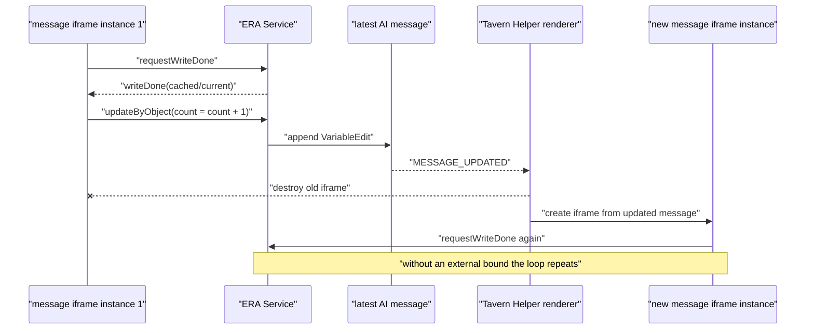
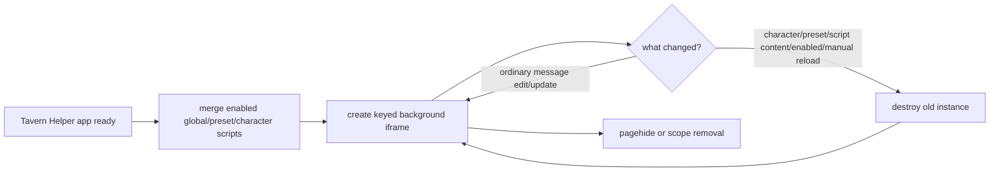
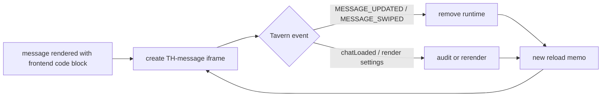
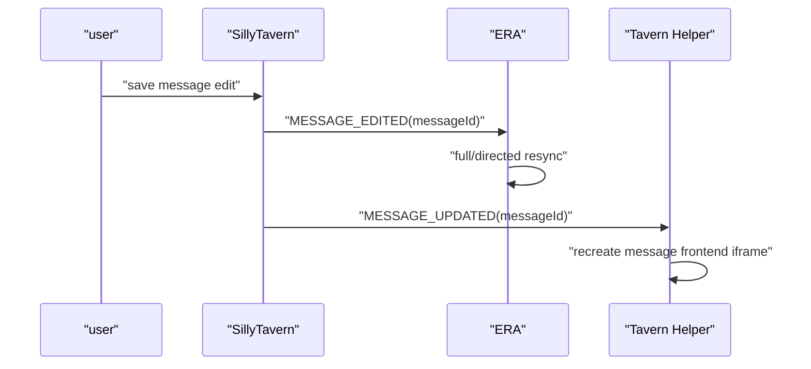
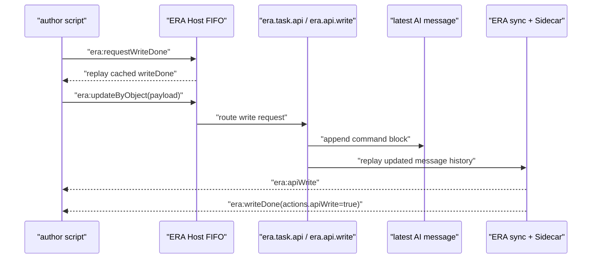

# ERA API 生命周期、调用语义与幂等策略调查

> 历史调查说明：本文保留 2026-08-24 的自激探针与当时的候选设计。当前源码结论、
> 状态栏来源楼层证据和完整重构比较已迁移到
> [`ERA状态栏根因与重构备选方案.md`](ERA%E7%8A%B6%E6%80%81%E6%A0%8F%E6%A0%B9%E5%9B%A0%E4%B8%8E%E9%87%8D%E6%9E%84%E5%A4%87%E9%80%89%E6%96%B9%E6%A1%88.md)。
> 本文的“推荐方案”不再作为当前实施决定。

## 结论先行

当前 ERA 存在一个可稳定复现的自激闭环：

```text
消息前端 iframe 加载
  → 请求 writeDone
  → 前端脚本调用 ERA 写 API
  → ERA 向末尾 AI 消息追加 Variable/Function 标签
  → Tavern Helper 刷新该消息并发出 MESSAGE_UPDATED
  → 该消息的 iframe 被销毁重建
  → 初始化脚本再次执行
```

隔离复现中，每个 iframe 实例内的脚本都只写一次，但回写仍造成连续重建：同一消息前端加载 5 次，有界门栅允许其中 3 个实例写入，最终消息含 3 个 `<VariableEdit>`，Sidecar 计数从 0 变为 3。如果不设调查门栅，该模式没有产品层的自动停止条件。

对照实验表明，角色卡后台脚本不是普通消息编辑时的主要重载源：一次真实 `MESSAGE_EDITED → MESSAGE_UPDATED` 过程中，后台探针的实例 ID 未改变，`loads=1`、`edits=1`。后台脚本仍会在角色/脚本树/启用状态/手动 reload 变化时重建，但这与消息前端的每次 `MESSAGE_UPDATED` 重建是两条不同的生命周期。

根因不是“ERA 缺少一个 payload 相等去重”，而是当前调用合同没有表达业务意图和因果身份的位置。相同 payload 可能是：

- 一次脚本运行中有意的多次写入；
- 两个不同业务位置的合法操作；
- 用户每次编辑都应累加的操作；
- 同一因果周期因 iframe 重建而意外重放的操作。

因此，不应改变现有 API 的默认 `always` 语义，也不应用 payload hash 自动合并。推荐的根因方案是：

1. 为 `writeDone` 和同步结果增加稳定因果令牌；
2. 为新的显式 effect 合同增加业务 `key` 和执行策略；
3. 用“消息内最小 effect 标记 + Sidecar 派生执行索引”保持可重放历史与快速判定一致；
4. 后续再为高频需求提供声明式 effect；Tavern Helper 来源身份作为诊断和默认填充，不单独承担业务幂等性。

## 调查边界与版本

| 组件                            | 当前基线                          | 本轮处置                                     |
| ------------------------------- | --------------------------------- | -------------------------------------------- |
| ERA-vibeFlow                    | HEAD `7f13f86f`                   | 只读检查，未修改 ABI/产品逻辑                |
| SillyTavern                     | `1.18.0`，当前目录无 Git metadata | 只读检查生效消息编辑链                       |
| Tavern Helper / JS-Slash-Runner | HEAD `3cae54c`，`4.8.19`          | 只读检查 iframe/runtime/event 实现           |
| ERA-Test-Pack                   | HEAD `87ea86d`，Pack `0.6.0`      | 新增两个不进 canonical 的调查 Test File      |
| ST-Test-Harness                 | HEAD `7e57938`                    | 只使用现有通用生成/编辑/观察能力；无源码修改 |

本文后半部出现的 API 和数据结构全部是候选合同，不是已实现 ABI。正式实现需要另起 VibeFlow planned review。

## 当前生效代码证据

### 角色卡后台脚本

Tavern Helper 从 global、preset 和 character 三类脚本树组装启用脚本，runtime 的关键输入为 `id/name/source/content/reload_memo`：

- `JS-Slash-Runner/src/store/iframe_runtimes/script.ts:10-44`。

普通消息编辑不修改这些输入，因此不会自然重建后台 iframe。

### 消息前端 iframe

Tavern Helper 对 `CHARACTER_MESSAGE_RENDERED`、`USER_MESSAGE_RENDERED`、`MESSAGE_UPDATED` 和 `MESSAGE_SWIPED` 重新审计受影响消息，先从 runtime 数组中剔除旧对象，再以新 `reload_memo` 渲染：

- `JS-Slash-Runner/src/store/iframe_runtimes/message.ts:70-125` 及其紧随的事件处理。

### SillyTavern 消息编辑

SillyTavern 的 `messageEditDone` 先更新消息，然后发出 `MESSAGE_EDITED`，重绘 DOM，再发出 `MESSAGE_UPDATED`：

- `SillyTavern/public/script.js:8337-8373`。

### ERA API 回写

ERA 当前从末尾向前选择最后一条非 user 消息，直接计算 `originalContent + directive.block`：

- `javascript_project/service/base_lib/domain/api_write_engine.ts:246-270`。

Tavern Helper `setChatMessages` 默认 `refresh='affected'`，在修改后调用 `refreshOneMessage`：

- `JS-Slash-Runner/src/function/chat_message.ts:167-190`、`290-296`。

### 调用者身份丢失

Tavern Helper 为 listener 维护了按 iframe 分组的卸载映射，但 `_eventEmit` 只执行 `eventSource.emit(event_type, ...data)`：

- `JS-Slash-Runner/src/function/event.ts:8-35`、`114-128`。

ERA 应用层 `EraInboundEvent` 也只有 `type/source/args/occurredAt`：

- `app/src/ERA变量框架/service/types.ts:53-59`。

因此，Host 后续分配的 `eventId/sequence` 只能唯一标识“ERA 已接收的这个事件”，不能回答“它来自哪个 iframe/脚本/业务效果”。

### writeDone 信息不足

现有 `WriteDonePayload` 含 MK、message ID、actions、SelectedMks、EditLogs、状态和 `consecutiveProcessingCount`：

- `app/src/ERA变量框架/utils/constants.ts:167-235`。

`consecutiveProcessingCount` 不是稳定因果 ID：它可能在同 MK 上递增，不能区分用户编辑、API 回写、requestWriteDone 重放或新 AI 回复的根因。

## 真实隔离实验

### 实验 A：消息前端自激回写

- Test File: `ERA-Test-Pack/docs/test-runs/2026-08-24-era-api-lifecycle-idempotency/era-api-message-frontend-probe.jsonc`。
- 有效 run: `st-run-20260824T08090481-f1c09178614c`。
- recording: `1/1 completed`。
- evaluation: `passed`（通过代表“成功复现预期的当前缺陷”，不代表产品行为正确）。
- audit: `structuralStatus=consistent`、`recorderEvidenceStatus=complete`。

探针把写入上限固定为 3，并在每个 iframe 实例内只响应一次 `writeDone`。实际时序：



可定位证据：

- console 记录同一楼层名 `TH-message--3--0` 的 `loads=1..5`；
- 三条 write 记录分别为 `writes=1/2/3`；
- 末尾消息含 3 个相同 `<VariableEdit>`；
- Sidecar `statData.api_lifecycle_probe.count=3`；
- 同一 MK 的 EditLog 为 `0→1`、`1→2`、`2→3`。

首次调查 run `st-run-20260824T08064946-330257b5c341` 因调查文件把 observation checkpoint 写成了非合同值而在执行前终止；它是测试编排样本，不是产品结论，也未与有效 run 拼接。

### 实验 B：角色卡后台脚本对照

- Test File: `ERA-Test-Pack/docs/test-runs/2026-08-24-era-api-lifecycle-idempotency/era-api-background-script-probe.jsonc`。
- run: `st-run-20260824T08124666-d2d94faefb0f`。
- recording/evaluation: `1/1 completed/passed`。
- audit: `consistent/complete`。

调查路径在隔离角色卡中动态添加一个后台脚本，记录随机 instance ID，然后真实编辑最后一条消息。证据为：

```text
load: instance=d31fbaa8-... loads=1 edits=0
edit: instance=d31fbaa8-... loads=1 edits=1
observer: loads=1 edits=1 instances=[d31fbaa8-...]
```

后台脚本收到 `message_edited`，但没有重建。同时消息前端 observer 本身在编辑完成后渲染两次，再次证明两种 iframe 生命周期不同。

### 状态栏读取方向的关联缺陷

快速初始化首帧、多楼错位和旧聊天恢复三种状态栏表现及其最新自动测试证据，统一维护在
[`../testing/ERA当前缺陷基线.md`](../testing/ERA当前缺陷基线.md)。本文不再重复维护其当前状态；
这里只保留与消息前端重建和 API effect 幂等设计直接相关的生命周期机制。

### 现有测试覆盖与缺口

已有正式回归证明了下列基础能力：

- `RUNTIME-API-BURST-WRITES-001`：同一 burst 内三次写不同路径；
- `RUNTIME-API-BURST-SAME-PATH-001`：同一 burst 中 insert、update、update 按 FIFO 结算；
- `RUNTIME-API-CONCURRENT-QUERIES-001`：相同参数和不同参数的并发查询；
- `RUNTIME-API-REQUEST-WRITE-DONE-001`：连续三次 requestWriteDone；
- `RUNTIME-COMBO-EDIT-TWICE-CONTINUE-001`：同楼连续编辑后 continue。

上述路径在已完成的完整回归 `st-run-20260823T18200673-dc884ab8c21b` 中均 passed。但在本轮前，Pack 没有任何 `message_iframe_render_*`、`TH-message--`、HTML 消息前端或“`requestWriteDone → API 回写 → 同 iframe 重建`”闭环路径。因此现有 API/FIFO/编辑测试可以同时全部通过，却不会触发这个生命周期缺陷。

状态栏首帧的现行覆盖、严格读取字段和修复验收见
[`../testing/ERA当前缺陷基线.md`](../testing/ERA当前缺陷基线.md)。

## 四条生命周期

### 1. 角色卡后台脚本



### 2. 消息前端 iframe



### 3. SillyTavern 编辑事件



### 4. requestWriteDone / writeDone / API 追加



现有链可以证明每个 Host 事件被 FIFO 唯一结算，但不能证明两个 Host 事件是两次业务意图，还是同一业务意图被两个 iframe 实例重放。

## 作者需求矩阵

| 作者意图                    | 示例                          | 应执行几次                    | 必需身份                                     | 现有 ERA                      |
| --------------------------- | ----------------------------- | ----------------------------- | -------------------------------------------- | ----------------------------- |
| 每次调用都执行              | 一次脚本连续 `+10`、`+10`     | 2                             | Host 调用序号                                | 支持，应保持默认              |
| 相同 payload 的不同业务用途 | “自然恢复”与“道具恢复”各 `+5` | 2                             | 不同 effect key                              | 无法区分                      |
| 每次用户编辑执行一次        | 编辑时间线就 `+1`             | 每个 edit cause 1 次          | message stable ID + edit revision/cause      | 无稳定 edit token             |
| 每次真实 AI 回复执行一次    | 每轮时间 `+10 分钟`           | 每个 AI cause 1 次            | generation/root cause ID                     | 无                            |
| 每个 writeDone 因果周期一次 | UI 收到当前状态后补一个效果   | 重放同一 writeDone 仍只 1 次  | stable cause/cycle ID + effect key           | 无                            |
| 当前 AI 消息中第一次有效    | 该楼 UI 初次出现时标记已读    | 每个 logical message 1 次     | stable message ID + effect key               | message_id/MK 不足以独立承担  |
| 当前聊天只一次              | 新游戏初始化                  | 每个 Sidecar/chat 1 次        | Sidecar ID + effect key                      | 无执行账本                    |
| 当前 ERA 运行期只一次       | 本页面会话初始化缓存          | 每个 ERA runtime 1 次         | ERA runtime ID + effect key                  | 无公开 runtime ID             |
| 首次安装只一次              | 角色卡脚本首次启用时初始化    | 每个 script installation 1 次 | script ID + installation scope/ID            | 不传调用 script ID            |
| 并发相同 effect             | 两个 UI 区块同时申请初始化    | 按策略 1 次或 2 次            | effect key + cause + FIFO atomic reservation | 仅有 FIFO，无 effect identity |
| 后台脚本来源                | 卡脚本中的游戏逻辑            | 由明确策略决定                | script ID + instance ID                      | 发送时丢失                    |
| 当前/历史消息前端           | 每楼的 HTML UI                | 按所属 logical message 决定   | message ID + swipe/branch + iframe instance  | 发送时丢失                    |

## 建议的身份模型

不是每个策略都需要下列全部字段，但需先区分它们的职责：

| 身份                         | 作用                                                         | 持久化                          |
| ---------------------------- | ------------------------------------------------------------ | ------------------------------- |
| `sidecarId`                  | 独立聊天变量/函数/效果账本的根                               | 聊天指针 + Sidecar              |
| `characterId/groupId/chatId` | 防止异步调用写到已切换聊天                                   | Sidecar owner，执行前重读       |
| `branchId`                   | 区分 swipe/分支上的 effect                                   | 建议由当前消息链派生            |
| `logicalMessageId`           | 稳定标识一个逻辑楼层，不随编辑换 MK                          | 消息内最小 ERA metadata         |
| `messageRevision`            | 区分对同一楼的每次编辑                                       | 由 ERA 消费真实 edit 事件时推进 |
| `causeId`                    | 一次 AI 回复、编辑、swipe、显式 full sync 等根原因           | writeDone + 最小持久化因果索引  |
| `rootCauseId/parentCauseId`  | 使 API 回写引发的后续 sync 继承原因，不伪装成新 AI/edit 周期 | Sidecar 索引与 writeDone        |
| `callerKind`                 | `character-script` / `message-frontend` / `unknown`          | 调用 envelope，可诊断           |
| `callerId`                   | script ID 或 logical message ID                              | 调用 envelope                   |
| `callerInstanceId`           | 区分同一脚本的重建实例                                       | 通常只在运行期/诊断中保留       |
| `effectKey`                  | 作者定义的稳定业务操作名                                     | 消息 effect 标记 + Sidecar 索引 |
| `callOrdinal`                | 允许同一实例内多次同 key 调用在 `always` 下按序结算          | receipt/诊断，不用于自动去重    |

一个重要限制是：当前 MK 会因消息编辑/重建而变化，而数组 message ID 会因中间插入/删除而移位。二者都不能单独作为 `once-per-message` 的永久业务身份。

## 历史修改和权威规则

与 ERA 现在“消息中指令是可重放历史事实，Sidecar 是当前状态源”一致，effect 幂等性建议遵守：

- **手工编辑或删除 API 标签**：与之绑定的 effect 标记应作为同一个不可分割 envelope。删除 envelope 表示从历史中撤销该 effect，full sync 后 Sidecar 派生索引也删除。
- **只删标记或只删命令**：视为损坏 envelope，诊断并 fail-closed，不静默重复执行或伪造已执行。
- **分支/Swipe**：消息 effect envelope 天然属于所在 swipe；Sidecar 索引只对当前 selected branch 生效，切换时重建。
- **聊天导入**：消息内标记随聊天移植。若对应 Sidecar 不存在，可从历史重建。
- **Sidecar 迁移/复制**：迁移保留 effect 历史和账本；聊天复制用新 Sidecar，但从消息历史重建已结算 envelope，不把原聊天的 runtime-only 标记复制过去。
- **API 回写后文件提交失败**：消息 envelope 已是可重放真相；修复/full sync 从消息恢复 Sidecar，不再追加第二份 effect。

## 方案一：显式执行策略

### 原理

保留所有旧调用：

```ts
eventEmit("era:updateByObject", payload); // 仍为 always
```

新增一个不与旧 args 混淆的 effect API，例如：

```ts
eventEmit("era:executeEffect", {
  operation: "updateByObject",
  args: [{ world: { minute: { $expr: "world.minute + 10" } } }],
  effect: {
    key: "clock.advance-after-ai",
    policy: "once-per-cause",
    causeId: writeDone.cause.id,
  },
});
```

候选 policy：

- `always`：每次执行；
- `once-per-cause`：同一 `causeId + effectKey` 一次；
- `once-per-message`：同一 `logicalMessageId + effectKey` 一次；
- `once-per-edit`：同一 `logicalMessageId + messageRevision + effectKey` 一次；
- `once-per-chat`：同一 `sidecarId + effectKey` 一次；
- `once-per-era-runtime`：只写内存运行期表，page reload 后重置。

“首次安装”不建议动用 Sidecar chat ledger 假装；它属于 script installation 作用域，应另用 script ID + 脚本设置存储。

### 并发和失败

- 同 `causeId + effectKey` 的并发调用依托现有 Host FIFO 在一个 Service 事务中预留，第一个执行，后续返回 `already-applied`。不需要新的全局锁。
- 重复不应伪装成 error；receipt 返回 `status='completed'` 与 `effectStatus='already-applied'`，不写消息、不进行同步。
- `causeId` 与当前聊天/分支不匹配时返回 `ERA_API_EFFECT_STALE_CONTEXT`，不写到已切换聊天。
- 两个相同 payload 若 effect key 不同，仍全部执行。
- 同一脚本运行中需要多次同类调用时，使用旧 API/`always`，或为不同业务 effect 使用不同 key。

### 范围与成本

- ERA Service + API 类型/文档 + ERA-Test-Pack。
- 如果作者显式传 `causeId`，不依赖 Tavern Helper 升级。
- 实现成本：中等；作者需要理解 key 和 policy。
- 单独使用时的限制：没有方案二的稳定 cause 就无法可靠实现 `once-per-ai/edit/writeDone-cycle`。

## 方案二：writeDone 因果令牌

### 原理

候选 `writeDone` 扩展：

```ts
type EraCause = {
  id: string;
  rootId: string;
  parentId: string | null;
  kind:
    | "ai-reply"
    | "message-edit"
    | "message-swipe"
    | "chat-load-replay"
    | "force-sync"
    | "api-write";
  sidecarId: string;
  branchId: string;
  logicalMessageId: string | null;
  messageRevision: number | null;
};
```

核心规则：

- 新 AI 回复、真实消息编辑、swipe 分别创建新 root cause。
- `requestWriteDone` 只重放已缓存的 cause，不创建新 cause。
- API 回写导致的后续 sync 创建 child cause，但继承原 `rootId`。否则每次 API 追加都会被误认为新周期，`once-per-cause` 仍无法停止自激。
- chat load/full replay 是状态恢复因果，不默认触发“每次 AI 回复”业务效果。

作者同步回调可直接传令牌。异步回调必须显式捕获 token：

```ts
eventOn("era:writeDone", (writeDone) => {
  const cause = writeDone.cause;
  setTimeout(() => {
    eventEmit("era:executeEffect", {
      operation: "updateByObject",
      args: [payload],
      effect: {
        key: "clock.advance",
        policy: "once-per-cause",
        causeId: cause.id,
      },
    });
  }, 1000);
});
```

不建议通过全局“当前 cause”自动继承异步任务：浏览器中没有可靠的 AsyncLocalStorage，全面 patch Promise/timer 的维护成本和侵入性过高。

### 范围与成本

- ERA 事件规划、sync 结果、writeDone 合同、API request DTO、Sidecar 因果索引、Pack。
- 实现成本：中高；它是其他策略的共享基础。
- 单独使用时的限制：令牌只提供“这是哪一轮”，不能表达作者是想每轮一次、每次调用，还是每聊天一次；仍需与方案一或三结合。

## 方案三：声明式效果注册

### 原理

把常见业务意图从“iframe 运行了几次”中解耦：

```ts
eventEmit("era:registerEffect", {
  key: "clock.advance-after-ai",
  trigger: "after-ai-reply",
  scope: "chat",
  operation: "updateByObject",
  args: [{ world: { minute: { $expr: "world.minute + 10" } } }],
});
```

ERA 在真实 Tavern 事件被分类为 `ai-reply`、`message-edit`、`chat-first-ready` 等后执行 effect，不把 iframe 每次初始化当成业务事件。

为保持可重放和可序列化，声明式 effect 应先只接受 ERA 已知 operation + JSON args，不接受任意 JavaScript callback。任意 callback 无法持久化，也无法在聊天历史上重放。

可选 trigger：

- `after-ai-reply`；
- `after-message-edit`；
- `after-swipe-selected`；
- `chat-first-ready`；
- `sidecar-first-created`。

### 范围与成本

- ERA Service 新的 effect registry/dispatcher Nodeset、Sidecar 注册项和执行索引、AI/API 文档、Pack。
- 实现成本：高，但作者使用成本最低，且最适合“每次 AI 回复”这类常见需求。
- 兼容性：旧 imperative API 仍为 `always`；新注册通道独立。
- 限制：不适合作者必须在运行时计算任意 JS 结果的全部情况，此时仍需方案一的 imperative effect API。

## 方案四：Tavern Helper 来源感知

### 原理

在 Tavern Helper 层增加新的显式来源感知通道，不静默改变所有现有 `eventEmit` 的 args：

```ts
eventEmitWithContext("era:updateByObject", payload);
```

或提供 ERA 专用 wrapper，由 Tavern Helper 注入：

```ts
{
  callerKind: 'character-script' | 'message-frontend',
  scriptId: string | null,
  messageId: number | null,
  iframeName: string,
  instanceId: string,
  emittedAt: number
}
```

这可以区分：

- 同一后台脚本实例内的两次调用；
- 同一消息前端因 `MESSAGE_UPDATED` 重建后的新实例；
- 当前消息前端与历史消息前端；
- 角色卡后台脚本与错误的 global/preset 脚本。

### 范围与成本

- Tavern Helper、ST-Test-Harness 通用桥接/来源观察、ERA ingress/Host DTO、ERA-Test-Pack。
- 实现成本：中高，涉及四仓协议升级。
- 优点：诊断能力最强，也可为作者自动填充 `callerId`。
- 关键限制：“这是新 iframe”不等于“这次业务效果应被忽略”。用户可能正是希望每次编辑/重载都累加；两个不同业务位置也可能在同 iframe 实例中使用相同 payload。所以来源感知不能单独代替 effect key + policy/cause。

## 三种持久化方式

| 方式                            | 优点                                                              | 问题                                                                            | 适合角色           |
| ------------------------------- | ----------------------------------------------------------------- | ------------------------------------------------------------------------------- | ------------------ |
| 消息内 API-origin/effect 标记   | 随聊天导出/导入；天然属于楼层与 swipe；full replay 可恢复         | 增加少量聊天文本；手工编辑可损坏 envelope；全局 once-per-chat 查找成本高        | 可移植的历史真相   |
| Sidecar 执行账本                | 查找快；适合 chat/runtime/cause 策略；不增加聊天文本              | 分支/历史编辑必须精确失效；只导入聊天时账本可缺失；标签已删但账本仍在时会误跳过 | 当前分支的快速索引 |
| 消息最小标记 + Sidecar 派生索引 | 兼顾可移植历史与快速判定；可从消息重建；与 ERA 现有可重放模型一致 | 需要定义原子 envelope、失效和压缩规则                                           | **推荐**           |

建议的消息形式不要把大量 caller 诊断数据写入聊天，只保留可重放所需的最小字段，例如一个包裹命令的版本化 effect ID。Sidecar `eraMeta.ApiEffects` 作为可重建索引，不成为与聊天历史冲突的第二业务真相。

## 方案对比

| 需求                  | 显式策略            | 因果令牌                  | 声明式 effect                        | TH 来源感知                |
| --------------------- | ------------------- | ------------------------- | ------------------------------------ | -------------------------- |
| 允许同一运行多次调用  | 完全支持，`always`  | 不冲突                    | 保留旧通道时支持                     | 可识别同实例，但不决定意图 |
| 每次编辑累加          | `once-per-edit`     | 提供 edit cause           | `after-message-edit`                 | 只能证明实例/来源          |
| 每 AI 回复一次        | `once-per-cause`    | 提供 ai cause             | `after-ai-reply` 最直接              | 不足                       |
| 同 writeDone 周期一次 | 需 cause key        | 核心能力                  | 内部可使用                           | 不足                       |
| 每消息一次            | `once-per-message`  | 需 message/cause identity | 可定义 trigger                       | 可自动提供 message 来源    |
| 每聊天一次            | `once-per-chat`     | 可作为注册原因            | `chat-first-ready`                   | 不足                       |
| 异步回调              | 显式传 token 可靠   | 显式捕获 token 可靠       | ERA 自主调度最可靠                   | 可传 origin，但仍需 token  |
| 开发改动              | ERA + Pack          | ERA + Pack                | ERA + Pack，规模最大                 | TH + Harness + ERA + Pack  |
| 独立解决根问题        | 需稳定 cause 才完整 | 需 effect 意图才完整      | 可解决预定 trigger，但不覆盖任意调用 | 不能                       |

## 推荐方案

推荐不是四选一，而是一条有顺序的组合路线：

### 第一阶段：因果令牌 + 显式 effect 策略 + 混合持久化

这是最小且完整的根因修复：

- 旧 16 个公开 API 保持每次调用都执行。
- 新 effect API 强制显式 `key + policy`，不猜 payload 意图。
- `writeDone.cause` 让 `once-per-ai`、`once-per-edit`、`once-per-writeDone-cycle` 可定义。
- API 回写继承 root cause，从根上切断消息前端自激。
- 消息中存最小 effect envelope，Sidecar 存派生索引，保持导入/分支/full replay 一致。

### 第二阶段：声明式常用效果

先实现 `after-ai-reply`、`after-message-edit`、`chat-first-ready` 三个高频 trigger，让作者不再通过 UI iframe 的初始化次数模拟业务事件。

### 第三阶段：Tavern Helper 来源上下文

作为诊断、安装作用域与默认 caller 填充能力。它不是第一阶段的强依赖，避免 ERA 的核心修复被多仓协议升级阻塞。

### 不推荐的单独方案

- **payload hash 去重**：会伤害同一运行内的合法重复和不同业务用途。
- **只看 iframe instance**：无法判断新实例是用户期望的每编辑累加，还是意外自激。
- **只加 writeDone cycle ID**：有“哪一轮”但没有“作者想要哪种执行范围”。
- **只存 Sidecar 账本**：消息标签被编辑/删除、分支切换或聊天导入时会与可重放历史分裂。
- **只存消息 marker**：可重放，但 `once-per-chat/cause` 查找与并发事务处理成本不理想。

## 未来 VibeFlow 接入位置

正式实现应在真实 Service workflow 中完成 planned review，Host 只负责机械传输。建议的实际接入点：

1. **因果建模**：在现有 `era.task.main` 的事件准备/路由中，为 sync/edit/swipe/generation 产生 cause context；不放入 Tavern adapter 业务逻辑。
2. **effect 判定**：在 `era.task.api` 路由到 `era.api.write` 之间增加 `era.api.effect_policy` Nodeset，于构造 `api_message_append_request` 之前读取当前身份、cause、消息 marker 和 Sidecar 索引。
3. **原子回写**：改造现有 `era.api.build_message_append`，让新 effect 命令与最小标记一次追加；旧 API 继续生成旧标签。
4. **Sidecar 索引**：在现有 sync Sidecar 成功提交后更新 `eraMeta.ApiEffects`；full sync/Swipe/历史编辑从当前分支消息 envelope 重建。
5. **writeDone**：在同步通知组装点输出 `cause`；`requestWriteDone` 保持重放同一 cause。
6. **声明式 dispatcher**：后续作为独立 `era.effects.dispatch` Nodeset 接在真实 cause 分类之后，输出现有 API write 任务，不复制 CRUD/同步引擎。

如果采用 Tavern Helper 来源通道，其 Host/Adapter 只应传入受限 caller envelope；“该不该执行”仍由 `era.api.effect_policy` 决定。

## 正式实现的测试规模

### ST-Test-Harness 通用能力（只在方案四入选时需要）

- 观察 background/message iframe 的 create/destroy/instance identity；
- 观察来源 envelope 是否与真实 iframe 一致；
- reload、消息编辑、Swipe、切聊天后来源变化；
- 能力保持通用，不包含 ERA effect 预期。

### ERA-Test-Pack 预计 32～40 条新路径

- 每次调用：同实例一次/两次/并发两次/相同 payload 不同 key；
- 因果：AI reply、最后楼编辑、中间楼编辑、连续编辑、API child sync、requestWriteDone replay；
- 策略：`always`、per-cause、per-message、per-edit、per-chat、per-runtime；
- 来源：后台脚本、当前消息前端、历史消息前端；
- 时序：同步调用、Promise/microtask、timer 异步、调用后立即切聊天；
- 历史：删除命令+marker、只删其一、full sync、Swipe、分支、聊天导入、Sidecar 迁移/复制；
- 故障：消息提交失败、Sidecar 提交失败、stale cause、损坏 ledger、并发同 key。

每条 required evaluation 同时检查：

- 是否追加且只追加应有数量的命令/envelope；
- Sidecar 最终状态和 `ApiEffects` 派生索引；
- receipt 的 `executed/already-applied/stale/failed`；
- `writeDone.cause` 的 root/parent 关系；
- 消息前端实例数与真实执行效果数不再绑定；
- full replay/Swipe/导入后结果一致；
- Artifact `consistent/complete`。

## 决策建议

进入正式 planned review 前，需由维护者确认两个 API 设计选择：

1. 新合同是使用单独 `era:executeEffect`（本文推荐，与旧 args 完全隔离），还是给每个旧写 API 增加可选第二参数；
2. 第一个声明式版本是否同时交付，或先只交付因果令牌 + imperative effect。

无论选择哪一项，以下默认已有充分证据支持：

- 旧 API 永远保持 `always`；
- 任何幂等性都需显式 effect key；
- 每 AI/每编辑/每 writeDone 周期需稳定 cause；
- 消息标记是可移植历史真相，Sidecar 账本是可重建索引；
- iframe 来源身份有价值，但不能代替作者意图。
